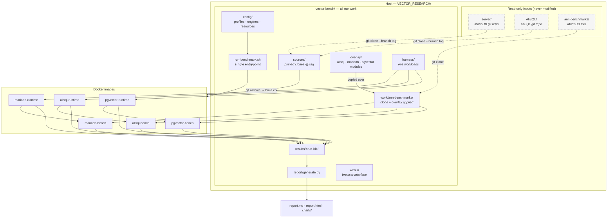
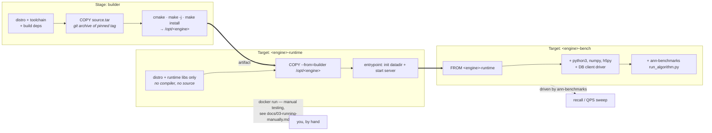
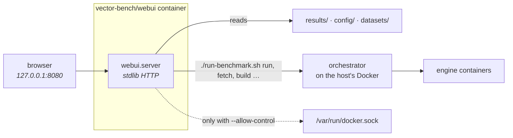
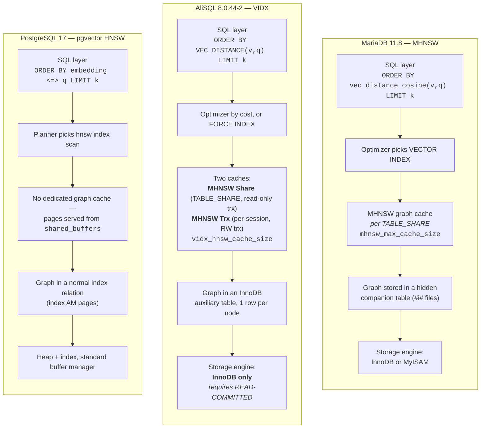
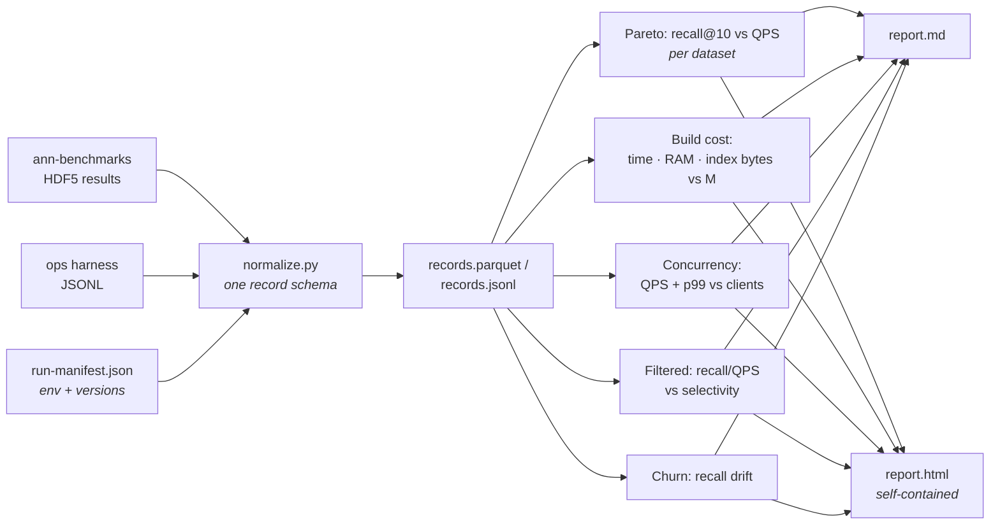

# Architecture

## 1. System overview

`vector-bench` is a self-contained directory. It never writes to the three vendor
repositories — it reads them, clones from them into its own `sources/`, and does
all work under its own tree.



The key structural point: **two independent measurement paths write into one
results directory.**

- The `*-bench` images run under ann-benchmarks and produce recall/QPS.
- The `*-runtime` images are driven directly by our ops harness and produce build
  cost, concurrency, filtered-search and churn numbers.

Both emit the same JSON-lines record schema, so the report generator does not
care which path produced a given metric.

## 2. Container build model

Each engine has one Dockerfile with two published targets.



`SOURCE_MODE` build-arg selects where the source tarball comes from:
`local` (default — `git archive` out of `sources/`) or `upstream` (clone from
GitHub inside the builder, for publishing a recipe others can rebuild).

## 3. The web UI

A fourth container, and the only one that is not part of a measurement. It
serves the browser interface: a run index, the manifest as a page, an explorer
over the records, and buttons for the long commands.



Three properties that are not obvious from the picture:

* **The repo is bind-mounted at its own absolute host path**, not at a tidy
  `/app`. The orchestrator hands *host* paths to the Docker daemon when it
  launches engine containers, so a container-only path would be resolved by the
  daemon against the host filesystem, where it does not exist, and the engine
  would come up with an empty mount.
* **The container runs as the invoking user.** As root, git refuses the
  bind-mounted working copy as "dubious ownership" — which stops every run
  before it starts — and everything written under `state/` and
  `config/profiles/` lands root-owned on the host.
* **The Docker socket is mounted only with `--allow-control`.** Read-only mode
  needs nothing but the filesystem, so it is safe to leave running.

Nothing runs alongside a benchmark: a download or a compile during an ingest
measurement perturbs exactly what is being measured. See
[08-web-ui.md](08-web-ui.md).

### Where an engine is defined

One file per engine, `config/engines/<name>.yml`, and the orchestrator reads the
directory rather than a list. Besides the build recipe and the server flags,
each carries a `runtime:` block:

| Key | Used for |
| --- | --- |
| `driver` | Which `harness/drivers/` class drives it. Several engines share one — `mariadb` and `mariadb123` are the same server at different tags |
| `ann_constructor` | The class name ann-benchmarks expects. Must be unique: it keys the result files |
| `port`, `data_mount`, `server_data_mount` | Where to connect and where its data lives inside the image |
| `credentials` | The bench account |
| `probe` | Readiness command, run until it succeeds |
| `chart`, `label`, `order` | How it is drawn and named, and where it sits in the ordering |

These were once six dictionaries keyed by engine name, spread across
`ann_pass`, `ops_pass`, `cli`, `charts` and `render`. Missing one did not fail
at load: it failed after a server had already started, or drew a recall chart
quietly missing a series.

Two consumers cannot read this file, and are given what they need instead:

* **`harness/`** runs in a container mounting `harness/` only, so the
  orchestrator passes `--driver`.
* **`report/`** mounts `report/` and `harness/` only, so each engine's colour
  and label are written into `run-manifest.json` and read back from there. An
  engine added later therefore draws and names itself correctly in a report
  without either package being edited.

Both constraints are enforced by tests, because both were violated in practice —
an orchestrator import inside `report/` once crashed generation at the end of a
twenty-hour run.

## 4. Vector-search internals, side by side

The original three engines solve the same problem with materially different
plumbing.
This is what the benchmark is actually measuring.



Consequences that show up in the results:

- **Cache design drives concurrency behaviour.** MariaDB's single per-share cache
  and AliSQL's share+transaction split respond differently as client count rises.
  pgvector inherits PostgreSQL's buffer manager, which is mature but not
  vector-aware.
- **Graph-in-a-table (MariaDB, AliSQL) vs graph-in-an-index-AM (pgvector)**
  changes what "index size on disk" means and how build cost scales.
- **`ef_construction` is only tunable in pgvector**, so build-quality tradeoffs
  are not symmetric.

## 5. Benchmark data flow

```mermaid
sequenceDiagram
    autonumber
    participant U as run-benchmark.sh
    participant D as datasets/
    participant I as Docker image
    participant E as Engine (in container)
    participant R as results/&lt;run-id&gt;/

    U->>U: resolve profile + engines + datasets<br/>collect sysinfo, write run-manifest.json
    U->>D: fetch HDF5 dataset (train, test, ground-truth)
    U->>I: build if image digest missing

    rect rgb(240, 246, 255)
    note over U,R: Path A — recall / QPS (ann-benchmarks)
    U->>I: run.py --algorithm &lt;engine&gt; --dataset … --runs N
    I->>E: start server, CREATE TABLE + VECTOR INDEX
    E->>E: ingest train vectors, build HNSW
    loop each ef_search in grid
        I->>E: query all test vectors, k=10
        E-->>I: neighbour ids + per-query latency
    end
    I->>R: results/&lt;dataset&gt;/&lt;k&gt;/&lt;engine&gt;/*.hdf5
    end

    rect rgb(245, 255, 245)
    note over U,R: Path B — ops harness
    U->>E: docker run &lt;engine&gt;-runtime (cpuset + mem limit)
    U->>E: ingest, timed; build index, timed
    E-->>U: build wall/CPU time, peak RSS (cgroup), index bytes
    U->>E: concurrency sweep 1→32 clients
    E-->>U: QPS + p50/p95/p99
    U->>E: filtered search @ 1% / 5% / 10% / 50% selectivity
    E-->>U: recall vs recomputed filtered ground truth
    U->>E: churn 10% / 25%, re-measure
    U->>R: results/ops/*.jsonl
    end

    U->>R: finalize manifest (durations, image digests)
    U->>U: report/generate.py
    U->>R: report.md · report.html · charts/*.svg
```

## 6. Results pipeline



A record is one row of:

```
run_id, engine, engine_version, dataset, metric_space, pass (normalized|tuned),
storage_engine, M, ef_construction, ef_search, k, clients, phase,
recall_at_k, qps, latency_p50_ms, latency_p95_ms, latency_p99_ms,
build_wall_s, build_cpu_s, peak_rss_bytes, index_bytes, ingest_rows_per_s,
selectivity, churn_fraction, timestamp
```

Unused fields are null. One flat schema keeps the report generator simple and
makes the raw data trivially queryable with any tool.
